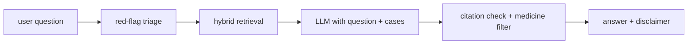
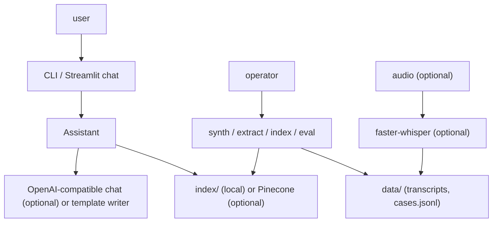
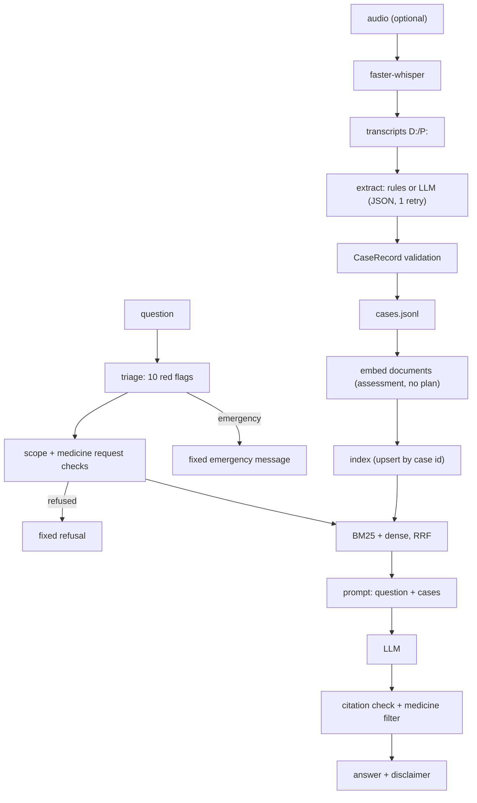

<div align="center">

# symptom-sage — A Safety-First Symptom RAG Over Simulated Interviews

**symptom-sage is a research assistant that compares a person's symptoms with simulated doctor-patient interviews. It takes interview transcripts through these steps to a cited, filtered answer:**

`transcribe` → `extract` → `index` → `triage` → `retrieve` → `answer` → `strip` → `evaluate`.


**[Summary](#1-summary)** ·
**[Workflow](#4-the-end-to-end-workflow)** ·
**[Run it](#10-how-to-run-symptom-sage)** ·
**[Configuration](#104-environment-variables)** ·
**[Known problems](#13-known-problems)** ·
**[Glossary](#15-glossary)**

</div>

> [!NOTE]
> This README uses ASD-STE100 Simplified Technical English. The writing rules and the project
> vocabulary are in [`docs/ste-style-guide.md`](docs/ste-style-guide.md). Each term in the
> [Glossary](#15-glossary) has only one meaning.

> [!WARNING]
> Do not use symptom-sage to make a medical decision. It is a research demo on simulated interviews.
> It does not diagnose and it does not recommend medicines. A doctor must review every health concern.

---

symptom-sage turns simulated doctor-patient interviews into validated case records and indexes them. A question first goes through red-flag triage. An emergency message gets an emergency answer and never reaches the retriever. Other questions get the most similar cases, and the prompt holds the question and the assessment of each case. The code then removes wrong citations and every sentence that names a medicine or a dose.

This README is the **one location that explains all of symptom-sage**. It gives these topics:

- the general design
- each component and its procedure, step by step
- the decision rules
- the data map
- the runbook
- the validation results and the known problems

| If you are… | Read |
|---|---|
| A manager or reviewer | [1](#1-summary), [3](#3-design-rules), [4](#4-the-end-to-end-workflow), [12](#12-validation-results), [14](#14-key-points) |
| A developer who joins the project | All sections, in sequence. Keep [10](#10-how-to-run-symptom-sage) and [13](#13-known-problems) open while you work |
| An operator who runs symptom-sage | [10](#10-how-to-run-symptom-sage), then the section for the component that you use |

---

## Table of contents

1. 🧭 [Summary](#1-summary)
2. 🏗️ [How symptom-sage is built](#2-how-symptom-sage-is-built)
   - 2.1 [Components](#21-components)
   - 2.2 [System context](#22-system-context)
   - 2.3 [Repository layout](#23-repository-layout)
3. 🛡️ [Design rules](#3-design-rules)
4. 🔄 [The end-to-end workflow](#4-the-end-to-end-workflow)
   - 4.1 [Full flow](#41-full-flow)
   - 4.2 [The life cycle of one question](#42-the-life-cycle-of-one-question)
5. 🔵 [Transcripts, speech and extraction](#5-transcripts-speech-and-extraction)
6. 🟢 [Index and retrieval](#6-index-and-retrieval)
7. 🟣 [The answer step](#7-the-answer-step)
8. ⚖️ [The safety model](#8-the-safety-model)
9. 🗂️ [Data and file map](#9-data-and-file-map)
10. ▶️ [How to run symptom-sage](#10-how-to-run-symptom-sage)
    - 10.1 [Prerequisites](#101-prerequisites) · 10.2 [Installation](#102-installation) · 10.3 [Run symptom-sage](#103-run-symptom-sage) · 10.4 [Environment variables](#104-environment-variables)
11. 🧩 [How to extend symptom-sage](#11-how-to-extend-symptom-sage)
12. ✅ [Validation results](#12-validation-results)
13. ⚠️ [Known problems](#13-known-problems)
14. 📌 [Key points](#14-key-points)
15. 📖 [Glossary](#15-glossary)
16. 📄 [License](#16-license)

---

## 1. Summary

**The problem.** A symptom chatbot that answers from retrieved cases can fail without a visible error. These questions are difficult:

- Does the model see the question, and does it see the assessments of the retrieved cases?
- What happens when a message describes an emergency?
- Can the answer include a medicine or a dose?
- How good are the transcripts, the extracted records and the retrieval, in numbers?

symptom-sage gives each of these questions its own component. The prompt template has the question and the case documents. The safety layer runs before and after the model. Each stage has its own evaluation.

| Item | Value |
|---|---|
| Input | Interview transcripts (`D:` / `P:`), optional audio, user questions |
| Output | Case records (`cases.jsonl`), an index, answers with case citations and a disclaimer, evaluation JSON |
| Components | **7**: transcripts and ASR, extraction, index and retrieval, LLM adapters, safety, assistant, evaluation |
| Providers | OpenAI-compatible chat and embeddings, faster-whisper, Pinecone. All optional |
| Offline mode | Synthetic interviews, rule extractor, hashing embedder, local index, template answer writer |
| Safety | 10 red-flag rules before retrieval, medicine refusal, out-of-scope refusal, medicine filter after generation |
| Tests | **31** unit tests (`pytest`), no skips |



---

## 2. How symptom-sage is built

### 2.1 Components

| Component | Module | Purpose |
|---|---|---|
| Settings | `src/symptom_sage/config.py` | Read and check environment variables. Hide keys in `repr` |
| Transcripts | `src/symptom_sage/transcripts.py` | Parse `D:` / `P:` turns, read UTF-8 and UTF-16 files |
| ASR | `src/symptom_sage/asr.py` | WER and CER with normalization, faster-whisper adapter |
| Lexicon | `src/symptom_sage/lexicon.py` | 40 symptoms with aliases, negation window |
| Extraction | `src/symptom_sage/extraction.py` | `CaseRecord` schema, rule extractor, LLM extractor with one retry |
| Store | `src/symptom_sage/store.py` | Read and write case records and failures |
| Synthetic data | `src/symptom_sage/synthetic.py` | Seeded interviews for 12 conditions with ground truth |
| Embeddings | `src/symptom_sage/retrieval/embeddings.py` | Hashing embedder (offline), OpenAI embedder |
| Index | `src/symptom_sage/retrieval/index.py` | Local numpy index, Pinecone adapter, upserts keyed by case id |
| Retrieval | `src/symptom_sage/retrieval/hybrid.py` | BM25 + dense, reciprocal rank fusion |
| LLM | `src/symptom_sage/llm.py` | OpenAI-compatible chat, scripted and template fakes |
| Safety | `src/symptom_sage/safety.py` | Red flags, scope checks, medicine filter, disclaimer |
| Assistant | `src/symptom_sage/rag.py` | Prompt, answer, citation check |
| Evaluation | `src/symptom_sage/evaluate.py` | Extraction, retrieval, answers, red-team set |
| CLI | `src/symptom_sage/cli.py` | The `symptom-sage` command |
| App | `src/symptom_sage/app/streamlit_app.py` | Optional Streamlit chat |

### 2.2 System context



### 2.3 Repository layout

```
symptom-sage/
├── src/symptom_sage/
│   ├── config.py          settings
│   ├── transcripts.py     transcript parser
│   ├── asr.py             WER, CER, faster-whisper
│   ├── lexicon.py         symptoms, aliases, negation
│   ├── extraction.py      CaseRecord, rule and LLM extractors
│   ├── store.py           JSONL records
│   ├── synthetic.py       synthetic interviews
│   ├── llm.py             LLM adapters and fakes
│   ├── safety.py          red flags, scope, medicine filter
│   ├── rag.py             Assistant
│   ├── evaluate.py        evaluations
│   ├── cli.py             symptom-sage command
│   ├── retrieval/         embeddings, index, hybrid
│   ├── resources/         redteam.json
│   └── app/               streamlit_app.py
├── data/README.md         dataset source, licence, layout
├── docs/ste-style-guide.md
├── tests/                 pytest suite (offline)
└── .github/workflows/ci.yml
```

---

## 3. Design rules

### 3.1 The prompt holds the question and the assessments
`USER_TEMPLATE` in `rag.py` has `{question}` and `{context}`. Each case document in the context ends with `Assessment: <condition>`. A test checks that the question text reaches the LLM.

### 3.2 Safety runs before retrieval
`triage()` in `safety.py` checks the question against 10 red-flag rules. An emergency gets a fixed message, and the retriever and the LLM are not called.

### 3.3 No medicine in an answer
The index document holds no plan. The system prompt forbids medicines. After generation, `strip_prescriptions()` removes each sentence that names a medicine, a dose, a unit such as `mg` or a prescription.

### 3.4 Citations are checked
The model must cite cases as `[CASE_ID]`. The assistant removes each citation of a case that was not retrieved and records it in `invalid_citations`.

### 3.5 Extraction is validated
Every record passes the `CaseRecord` schema. The LLM extractor parses JSON, retries once with the error and records a failure if the second reply also fails. One bad case does not stop the run.

### 3.6 The index is idempotent
The case id is the vector id. A second `index` run replaces the records with the same id. The local index refuses to load if it was built with a different embedder.

### 3.7 Each stage has a number
Speech has WER and extraction has field accuracy. Retrieval has leave-one-case-out hit@k. Answers have citation validity and medicine leaks. Safety has the red-team pass rate.

---

## 4. The end-to-end workflow

### 4.1 Full flow



### 4.2 The life cycle of one question

1. `triage()` finds the symptoms in the question and applies the red-flag rules.
2. If the level is `emergency`, the assistant returns the emergency message and the disclaimer. It stops there.
3. If the question asks for a medicine or a dose, the assistant returns the refusal.
4. If the question has no symptom and no medical word, the assistant returns the out-of-scope answer.
5. The retriever gets the top 5 cases by reciprocal rank fusion of BM25 and dense ranks.
6. Cases with a dense score below `SYMPTOM_SAGE_MIN_SCORE` and no BM25 match are dropped.
7. The LLM gets the system rules, the question and the case documents.
8. The assistant removes invalid citations and medicine sentences.
9. For an `urgent` level, the urgent message comes first.
10. The disclaimer comes last.

---

## 5. Transcripts, speech and extraction

**Purpose.** Turn interviews into validated case records.

| Input | Output |
|---|---|
| `<CASE_ID>.txt` transcripts, optional `.mp3` audio | `cases.jsonl`, `cases.failures.jsonl`, WER report |

**Procedure**

1. Read each file as UTF-8 or UTF-16. Some public files are UTF-16 with a damaged byte-order mark.
2. Parse the turns. A line without `D:` or `P:` continues the last turn.
3. Get the category from the case id prefix.
4. Extract the fields with the rule extractor or the LLM extractor.
5. Validate with `CaseRecord`. Normalize gender values and empty values such as `NA`.
6. Map symptoms to lexicon names. Keep unknown symptoms as lower-case text.
7. For speech: transcribe with faster-whisper, then calculate WER and CER against the reference transcript.

| Field | Rule extractor source | Validation |
|---|---|---|
| `age` | `NN years old` in patient turns, or the number after a doctor question about age | 0-120 or `null` |
| `gender` | `I'm a woman` / `I'm a man` in patient turns | `female`, `male`, `other`, `unknown` |
| `reason` | The first patient turn | 300 characters or less |
| `symptoms` | Lexicon matches in patient turns, without negated ones | Canonical names |
| `condition` | `could be` / `likely` / `probably` / `suspect` + phrase in doctor turns | Lower case, 120 characters or less |
| `plan` | `We will plan:` in doctor turns | 400 characters or less |

**Rules**

- WER normalization removes speaker tags, punctuation, case and filler words (`um`, `uh` and others) on both sides.
- The pooled WER is total errors divided by total reference words, for each category and for `ALL`.
- A record without a condition is not indexed.

---

## 6. Index and retrieval

**Purpose.** Store case documents and find the most similar cases for a question.

| Input | Output |
|---|---|
| Case records, a question | `Hit` list: case id, fused score, dense score, BM25 score, document |

**Procedure**

1. Build the document of each record: id, category, age, gender, symptoms, assessment.
2. Embed the documents. The hashing embedder adds a canonical token for each symptom, so aliases meet.
3. Upsert the vectors with the case id as the key.
4. For a question, rank all cases by dense cosine and by BM25.
5. Fuse the two ranks with reciprocal rank fusion (`1 / (60 + rank)`).
6. Return the top `SYMPTOM_SAGE_TOP_K` cases.

| Backend | Retriever | Notes |
|---|---|---|
| `local` (default) | `HybridRetriever` (BM25 + dense) | `index/vectors.npy` + `index/docs.json` |
| `pinecone` | `DenseRetriever` | Creates the index only if it is missing, batch upserts of 100, document in metadata |

---

## 7. The answer step

**Purpose.** Write a short answer from the retrieved cases only.

| Input | Output |
|---|---|
| Question, hits | `Answer`: text, triage, kind, cited ids, conditions, retrieved list, removed sentences, invalid citations |

**Procedure**

1. Build the prompt: `Question: ...`, then the case documents, most similar first.
2. Call the LLM with temperature 0 and seed 7 (OpenAI adapter).
3. Find the citations. Remove the citations of cases that were not retrieved.
4. Remove the sentences that name a medicine or a dose.
5. Set `conditions` from the assessments of the cited cases.
6. Add the disclaimer.

| LLM | When | Behaviour |
|---|---|---|
| `TemplateLLM` | `SYMPTOM_SAGE_LLM=fake` (default) | Lists the assessments in the context with their citations. It does not reason |
| `OpenAIChatLLM` | `SYMPTOM_SAGE_LLM=openai` | Any OpenAI-compatible chat server |
| `ScriptedLLM` | Tests | Prepared replies |

---

## 8. The safety model

| Red flag | Rule (symptoms in the question) | Level |
|---|---|---|
| possible heart attack | `chest pain` and one of `sweating`, `shortness of breath`, `fainting`, `dizziness` | `emergency` |
| possible stroke | one of `face drooping`, `slurred speech`, `weakness on one side` | `emergency` |
| possible anaphylaxis | `throat swelling` | `emergency` |
| possible meningitis | `stiff neck` and `fever` | `emergency` |
| sudden severe headache | `worst headache` | `emergency` |
| severe bleeding | `severe bleeding` | `emergency` |
| suicidal thoughts | `suicidal thoughts` (crisis line message) | `emergency` |
| coughing blood | `coughing blood` | `urgent` |
| blood in stool | `blood in stool` | `urgent` |
| fainting | `fainting` | `urgent` |

| Answer kind | When |
|---|---|
| `emergency` | A red flag with level `emergency` |
| `medication_refused` | The question asks for a dose, a prescription or which medicine to take |
| `out_of_scope` | No symptom and no medical word |
| `no_match` | No case passed the score limit |
| `urgent` | A red flag with level `urgent`. The answer follows the urgent message |
| `answer` | All other questions |

A negated symptom (`no fever`, `I don't have chest pain`) does not count. The medicine filter uses 28 medicine words and dose patterns (`mg`, `ml`, `tablet`, `dose`, `twice a day` and others).

---

## 9. Data and file map

| Path | Committed? | Contents |
|---|---|---|
| `src/symptom_sage/resources/redteam.json` | Yes | 22 risky prompts with the expected answer kind |
| `data/README.md` | Yes | Source, licence, layout |
| `data/synthetic/` | No (git ignores it) | Synthetic transcripts and `truth.jsonl` |
| `data/transcripts/`, `data/audio/` | No (git ignores it) | Public dataset files |
| `data/cases.jsonl`, `data/cases.failures.jsonl` | No (git ignores it) | Extracted records and failures |
| `index/` | No (git ignores it) | Local index |
| `.env`, `.streamlit/secrets.toml` | No (git ignores it) | Credentials |

---

## 10. How to run symptom-sage

### 10.1 Prerequisites

| Need | For |
|---|---|
| Python 3.11+ | All components |
| An OpenAI API key | `SYMPTOM_SAGE_LLM=openai`, `SYMPTOM_SAGE_EMBEDDER=openai`, `extract --extractor llm` |
| `asr` extra and FFmpeg | `asr-eval --audio-dir` |
| `pinecone` extra and a Pinecone key | `SYMPTOM_SAGE_INDEX_BACKEND=pinecone` |
| `app` extra | The Streamlit chat |

### 10.2 Installation

```bash
git clone https://github.com/KrishnaAnnavaram/symptom-sage.git
cd symptom-sage
python -m venv .venv
. .venv/bin/activate            # Windows: .venv\Scripts\activate
pip install -e ".[dev]"
```

### 10.3 Run symptom-sage

Offline demo:

```bash
symptom-sage demo --out demo_out
```

Offline flow, step by step:

```bash
symptom-sage synth --out data/synthetic
symptom-sage extract --transcripts data/synthetic/transcripts --out data/cases.jsonl
symptom-sage index --cases data/cases.jsonl
symptom-sage ask "I have a cough, fever and green phlegm"
symptom-sage eval all --cases data/cases.jsonl --truth data/synthetic/truth.jsonl
```

Public dataset with an LLM:

```bash
export OPENAI_API_KEY=...       # Windows PowerShell: $env:OPENAI_API_KEY = "..."
export SYMPTOM_SAGE_LLM=openai
symptom-sage extract --transcripts data/transcripts --out data/cases.jsonl --extractor llm
symptom-sage index --cases data/cases.jsonl
symptom-sage eval retrieval --cases data/cases.jsonl
symptom-sage asr-eval --ref-dir data/transcripts --audio-dir data/audio --save-dir outputs/asr
streamlit run src/symptom_sage/app/streamlit_app.py
```

| Command | Result |
|---|---|
| `symptom-sage synth` | Synthetic transcripts and ground truth |
| `symptom-sage extract` | `cases.jsonl` (and failures) |
| `symptom-sage index` | Builds or updates the index |
| `symptom-sage ask` | One answer (text or `--json`) |
| `symptom-sage chat` | Terminal chat |
| `symptom-sage eval {extraction,retrieval,answers,safety,all}` | Evaluation JSON |
| `symptom-sage asr-eval` | WER and CER from audio or from existing transcripts |
| `symptom-sage demo` | The full offline workflow |

### 10.4 Environment variables

| Variable | Used by | Meaning |
|---|---|---|
| `OPENAI_API_KEY` | LLM, embedder | OpenAI key |
| `PINECONE_API_KEY` | Pinecone index | Pinecone key |
| `SYMPTOM_SAGE_LLM` | Assistant, extractor | `fake` (default) or `openai` |
| `SYMPTOM_SAGE_EMBEDDER` | Index, retrieval | `hashing` (default) or `openai` |
| `SYMPTOM_SAGE_CHAT_MODEL` | LLM | Default `gpt-4o-mini` |
| `SYMPTOM_SAGE_EMBED_MODEL` | Embedder | Default `text-embedding-3-small` |
| `SYMPTOM_SAGE_OPENAI_BASE_URL` | LLM, embedder | Default `https://api.openai.com/v1` |
| `SYMPTOM_SAGE_INDEX_DIR` | Local index | Default `index` |
| `SYMPTOM_SAGE_INDEX_BACKEND` | Index | `local` (default) or `pinecone` |
| `SYMPTOM_SAGE_PINECONE_INDEX` | Pinecone | Default `symptom-sage-cases` |
| `SYMPTOM_SAGE_TOP_K` | Retrieval | Default 5 |
| `SYMPTOM_SAGE_MIN_SCORE` | Retrieval | Minimum dense score when BM25 has no match. Default 0.05 |
| `SYMPTOM_SAGE_WHISPER_MODEL` | ASR | Default `base` |

Credentials are only in a local `.env` file. Git ignores this file. Do not print or commit credentials.

---

## 11. How to extend symptom-sage

| You want to… | Do this | Code change? |
|---|---|---|
| Use another chat model or server | Set `SYMPTOM_SAGE_CHAT_MODEL` and `SYMPTOM_SAGE_OPENAI_BASE_URL` | No |
| Use Pinecone | Set `SYMPTOM_SAGE_INDEX_BACKEND=pinecone` and `PINECONE_API_KEY` | No |
| Add a symptom or an alias | Edit `SYMPTOMS` in `lexicon.py` | Small |
| Add a red flag | Add a `RedFlag` to `RED_FLAGS` and a prompt to `redteam.json` | Small |
| Add a red-team prompt | Add it to `resources/redteam.json` | No |
| Add a vector store | Write a class with `upsert()` and `query()` | Small |
| Add a faithfulness judge | Add a metric to `evaluate.py` that checks each sentence against the cited cases | Yes |

---

## 12. Validation results

| Validation | Result | Command |
|---|---|---|
| Unit tests | **31 passed**, 0 skipped (also in CI) | `pytest -q` |
| Red-team set (synthetic index) | 22 / 22 prompts get the expected answer kind | `symptom-sage demo` |
| Extraction, synthetic (96 cases) | age, gender and condition accuracy 1.000, symptom F1 0.998 | `symptom-sage demo` |
| Retrieval, leave-one-case-out, synthetic | hit@1 0.938, hit@3 0.979, hit@5 0.979 (chance 0.083, 0.250, 0.417) | `symptom-sage demo` |
| Answers, synthetic, held-out half | 41 of 48 answered (the rest are emergency answers), condition in answer 1.000, valid citations 1.000, medicine leaks 0 | `symptom-sage demo` |
| Rule extractor on the 272 public transcripts | age found in 17.3%, gender in 0.4%, a condition phrase in 34.9%, mean 3.5 symptoms per case | `symptom-sage extract --extractor rules` |

The synthetic interviews come from the same author as the rule extractor. Thus the synthetic numbers show that the parts work together, not that the system is accurate on real speech. The rule extractor finds few fields on the public transcripts, so use the LLM extractor for that data. No result with a real LLM, real embeddings or real audio is in this repository.

---

## 13. Known problems

Read these problems before you use symptom-sage in production.

| # | Area | Problem | Impact and action |
|---|---|---|---|
| 1 | Results | No result with a real LLM, real embeddings or real audio is in CI | Run `eval` and `asr-eval` with your keys and data |
| 2 | Coverage | The public dataset has 272 cases and about 78% are respiratory | The assistant cannot cover most conditions. Do not present it as a general symptom checker |
| 3 | Extraction | The rule extractor finds few fields on real transcripts | Use `--extractor llm` and check a labelled sample |
| 4 | Red flags | The rules use a fixed lexicon. Other words for an emergency are not found | Add aliases and red-team prompts. A human must review the rules |
| 5 | Negation | The negation window is 4 words before the symptom | Complex sentences can be read wrong |
| 6 | Faithfulness | There is no sentence-level judge. The checks cover citations and medicine words only | An LLM can still say something that the cases do not support |
| 7 | Privacy | With real conversations, the text goes to third-party APIs | Real use needs a privacy review, a BAA and PHI redaction |
| 8 | Bias | Acted interviews do not show the real range of patients and words | Results do not transfer to real patients |
| 9 | Use | This is not a medical device | Do not use it for diagnosis or treatment. A doctor must review every concern |

---

## 14. Key points

1. **The question reaches the model.** The prompt has the question and the assessment of each case.
2. **Emergencies stop the pipeline.** Ten red-flag rules run before retrieval.
3. **No medicine in an answer.** The plan is not indexed, and a filter removes medicine sentences.
4. **Citations must point to retrieved cases.** The assistant removes the other citations.
5. **Each stage has a number.** WER, field accuracy, hit@k, citation validity and the red-team pass rate.
6. **Bad data does not stop a run.** Each extraction failure goes to a failures file.

---

## 15. Glossary

| Term | Meaning |
|---|---|
| **Answer kind** | `emergency`, `urgent`, `medication_refused`, `out_of_scope`, `no_match` or `answer` |
| **Assessment** | The condition that the doctor names at the end of the interview |
| **BM25** | A word-match ranking function |
| **Case** | One interview with its case id |
| **Case record** | The validated `CaseRecord` of one case |
| **CER** | Character error rate |
| **Disclaimer** | The fixed text at the end of each answer |
| **Document** | The text of a case in the index |
| **Hit** | One retrieved case with its scores |
| **hit@k** | Share of questions where the true assessment is in the top k cases |
| **Index** | The vector store of case documents |
| **Plan** | The next steps that the doctor names. Never shown to the user |
| **Red flag** | A rule that sends the user to emergency or urgent care |
| **Red-team set** | The fixed list of risky prompts with the expected answer kind |
| **RRF** | Reciprocal rank fusion: `1 / (60 + rank)` summed over rankers |
| **Symptom** | A canonical name from the lexicon |
| **Transcript** | The text of an interview with `D:` and `P:` turns |
| **Triage level** | `emergency`, `urgent` or `routine` |
| **WER** | Word error rate after normalization |

---

## 16. License

[MIT](LICENSE) © 2026 Krishna Annavaram
